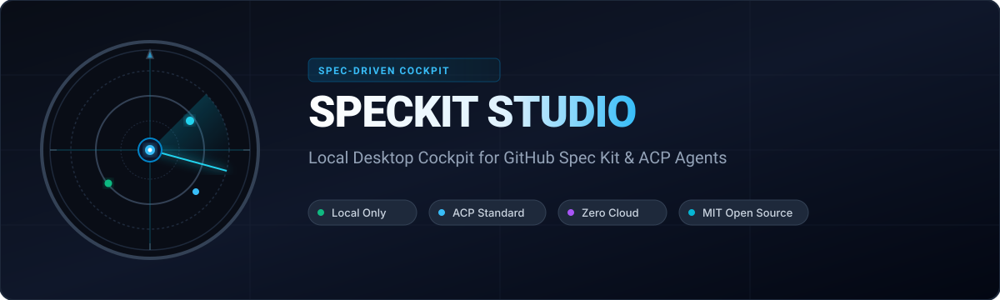

  

  
  
  
  
  

  <b>Speckit Studio</b> is a local desktop cockpit for <a href="https://github.com/github/spec-kit">GitHub Spec Kit</a>. Run the full Spec-Driven Development loop (<tt>constitution &rarr; specify &rarr; clarify &rarr; plan &rarr; tasks &rarr; analyze &rarr; implement</tt>) directly alongside your coding agents, follow every spec's phase on a Kanban board, and manage epics, roadmaps, dependencies, and wiki docs right inside your local repository.

  <video width="640" height="360" controls>
    <source src="docs/media/speckit-studio-intro.mp4" type="video/mp4">
    Your browser does not support the video tag.
  </video>
   
  ▶ <a href="docs/media/speckit-studio-intro.mp4">Speckit Studio Intro-Video ansehen (35 Sek.)</a>

  A personal project by <a href="https://github.com/flojud">Florian Jud</a>, shared as open source under the MIT License. It builds on GitHub Spec Kit but is not affiliated with GitHub.

---

## ⚡ Core Principles

- **Local Only & Zero Cloud**: Your specifications, plans, tasks, constitution, and wiki remain standard Markdown files in your Git repository. Studio-specific data (epics, milestones, dependencies, run sessions) is stored in a fast local SQLite database. No accounts, no telemetry, no cloud dependencies.
- **Agent-Agnostic via ACP**: Connect **Claude Code**, **Google Antigravity**, or any agent implementing the [Agent Client Protocol](https://agentclientprotocol.com). Authentication occurs inside the agent CLI; Speckit Studio stores zero credentials or API keys.
- **Files Are Truth**: Spec phases, task completion, and documentation are derived directly from the filesystem. What you see in the Studio is what exists on disk and in Git.
- **Live Agent Streaming**: Agent responses, tool calls, bash executions, and permission prompts stream in real time into the interactive Run Panel. One-click clarify options let you steer agents effortlessly.

---

## 🧭 Features

| Feature | Description |
|---|---|
| **Project Dashboard** | Default landing view per project: Kanban flow (stage counts, WIP, bottlenecks), milestones with completion and overdue flags, epic progress, and recent agent runs. |
| **Spec Board** | Kanban-style board organizing specs by phase (`specify`, `clarify`, `plan`, `tasks`, `analyze`, `implement`, `done`). Drag cards to trigger the next workflow phase. Filter by epic, milestone, or blocked status. |
| **Work Items** | Non-code work (business plans, marketing, research, docs) as Markdown with frontmatter in `work-items/WI-###-<slug>.md`. Link to epics/milestones, show on the board (Specs / Work items / All), and run an agent on them with a plain prompt. |
| **Spec Detail** | Inspect all generated artifacts (`spec.md`, `plan.md`, `research.md`, `contracts/`, `quickstart.md`). Interactive task checklists write directly back to `tasks.md`. Inspect analysis reports and assign epics or milestones. |
| **Agent Run Panel** | Real-time ACP agent sessions with interactive tool approvals, follow-ups, and cancellations. Run parallel implementations safely across Git worktrees. |
| **Roadmap & Calendar** | Matrix grid plotting milestones &times; epics with progress rollups and interactive date schedules. |
| **Constitution Editor** | Live markdown preview and agent-guided constitutional amendments. Automatically flags specifications created before constitution revisions. |
| **Project Wiki** | Local `docs/wiki/*.md` repository wiki supporting `[[wikilinks]]`, automatic backlinks, and one-click promotion from spec artifacts. |
| **Agent Config & Settings** | ACP agent registry browser, custom agent commands, phase-specific agent assignments, and environment diagnostic checks. |
| **Keyboard-First Navigation** | Global command palette (`Cmd/Ctrl+K`), quick spec creation (`C`), and quick panel dismissal (`Esc`). |

---

## ⬇️ Download

The latest release – every update of `main` that passes CI is released automatically:

| Platform | Download |
|---|---|
| macOS (Apple Silicon) | [speckit-studio-mac-arm64.dmg](https://github.com/flojud/speckit-studio/releases/latest/download/speckit-studio-mac-arm64.dmg) |
| macOS (Intel) | [speckit-studio-mac-x64.dmg](https://github.com/flojud/speckit-studio/releases/latest/download/speckit-studio-mac-x64.dmg) |
| Windows (x64) | [speckit-studio-win-x64.exe](https://github.com/flojud/speckit-studio/releases/latest/download/speckit-studio-win-x64.exe) |
| Linux (x64) | [speckit-studio-linux-x86_64.AppImage](https://github.com/flojud/speckit-studio/releases/latest/download/speckit-studio-linux-x86_64.AppImage) |

Older versions are on the [releases page](https://github.com/flojud/speckit-studio/releases).

> **The builds are not signed yet.** Your system will warn you the first time:
> - **macOS** says Apple could not verify the app is free of malware. Move it to Applications, click *Done*, then open *System Settings → Privacy & Security* and click *Open Anyway* – or run `xattr -cr "/Applications/speckit studio.app"` once.
> - **Windows** SmartScreen: click *More info → Run anyway*.
> - **Linux**: make the file executable with `chmod +x speckit-studio-linux-x86_64.AppImage`.

### What you need besides the app

- **Git**, and **Spec Kit** – the `specify` CLI or [`uv`](https://docs.astral.sh/uv/) (the app can run `specify init` for you).
- **A coding agent**: [Claude Code](https://github.com/anthropics/claude-code) (its ACP adapter runs via `npx`, so Node.js is needed), Google Antigravity (`agy`), or any other [ACP](https://agentclientprotocol.com) agent. You can install agents from the app's Settings.

The app checks all of this under **Settings → Environment**.

Want to build it yourself or work on it? The [Contributing Guide](CONTRIBUTING.md) explains the setup.

---

## 🤝 Contributing

I build Speckit Studio in my spare time and I'm happy about everyone who wants to join in – bug reports, ideas and pull requests are all welcome.
- The [**Contributing Guide**](CONTRIBUTING.md) explains the setup and how changes are made here.
- The [**Code of Conduct**](CODE_OF_CONDUCT.md) (Contributor Covenant 2.1) applies to everyone taking part.
- Security issues please report privately as described in the [**Security Policy**](SECURITY.md).

---

## 📄 License

Speckit Studio is open-source software licensed under the **[MIT License](LICENSE)**.  
Copyright &copy; 2026 Florian Jud.
